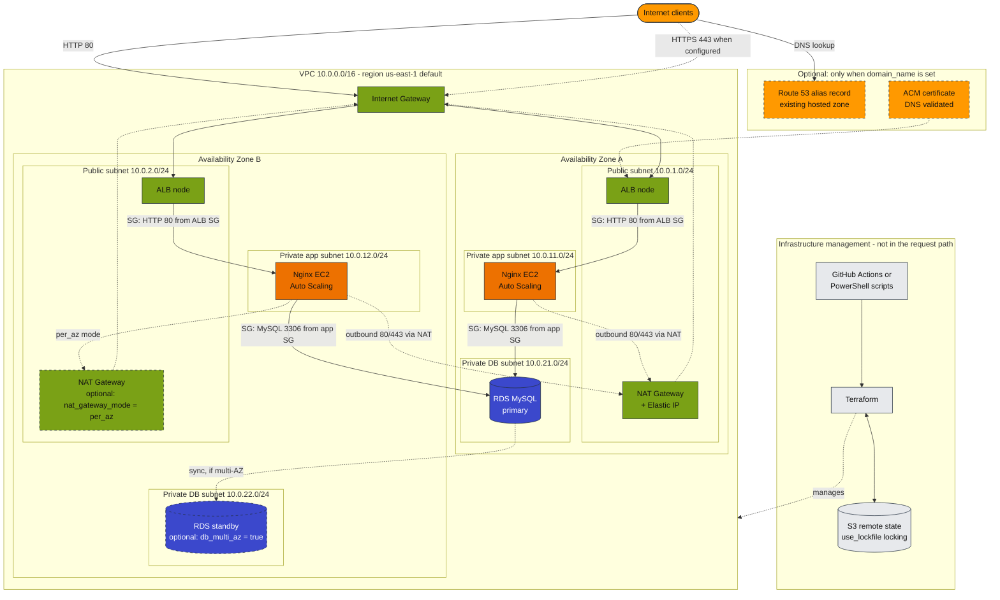

# AWS Enterprise Three-Tier Cloud Platform (Terraform)


Modular Terraform for a two-AZ, three-tier AWS platform: a public **Application Load Balancer**, a private **Auto Scaling** tier running **Nginx** on Amazon Linux 2023, and a private **RDS MySQL** database. Remote state lives in S3 with native lockfile locking.

> **Project status: not verified against AWS.**
> The code has been statically validated (`terraform fmt`, `init -backend=false`, `validate`). This README does not claim that any infrastructure is deployed, and the S3 backend, ACM, Route 53 and RDS behaviour have not been verified end to end. The deploy workflow can run `plan` and `apply` (see [CI/CD](#cicd-github-actions)), but nothing here states that a run succeeded. There are no test results, cost measurements or performance figures in this project.

## Contents

[Architecture](#architecture) · [Features](#features) · [Traffic flow](#traffic-flow) · [Security design](#security-design) · [Modules](#modules) · [AWS resources](#aws-resources-and-purpose) · [Repository layout](#repository-layout) · [Requirements](#requirements) · [State backend](#state-backend) · [Variables and secrets](#variables-and-secrets) · [HTTPS and Route 53](#https-domain-and-route-53) · [Code examples](#code-examples) · [CI/CD](#cicd-github-actions) · [Cost warnings](#cost-warnings) · [Commands](#commands-windows-powershell) · [Cleanup](#cleanup) · [Troubleshooting](#troubleshooting)

## Architecture

The diagram source is [`architecture/architecture.mmd`](architecture/architecture.mmd) (Mermaid), and GitHub renders the copy below. A rendered `architecture/architecture.png` is **not** included: no local Mermaid renderer was available, so none was generated. To produce one yourself:

```bash
npx @mermaid-js/mermaid-cli -i architecture/architecture.mmd -o architecture/architecture.png
```

Solid arrows are the request path; dotted arrows are optional or non-request flows. The AZ placement of the ALB nodes, the primary database and the optional standby is illustrative: AWS decides the standby location when `db_multi_az = true`. The diagram syntax has not been checked with a local Mermaid validator.



## Features

- One VPC (default `10.0.0.0/16`) with six subnets across exactly two AZs chosen dynamically from the region.
- Public ALB; Nginx instances and RDS in private subnets. Instances have no public IP and no SSH key.
- HTTPS with an ACM certificate (DNS validation) and an HTTP-to-HTTPS redirect when `domain_name` is set. Otherwise, HTTP-only mode must be opted into with `allow_http_only = true`.
- Auto Scaling group with a CPU target-tracking policy and an ALB health check.
- Encrypted EBS and RDS storage, IMDSv2 required on instances, RDS not publicly accessible.
- One NAT Gateway (cheapest) or one per AZ.
- S3 remote state with `use_lockfile` (no DynamoDB table).
- GitHub Actions deploy and destroy workflows, plus local PowerShell scripts.

## Traffic flow

1. Clients resolve the name (Route 53 alias, when `hosted_zone_id` is supplied) and reach the ALB through the Internet Gateway on port 80 or, when HTTPS is configured, 443.
2. With HTTPS enabled, the ALB terminates TLS with the ACM certificate and port 80 redirects to 443.
3. The ALB forwards to Nginx in the private app subnets on port 80; the app security group accepts that port only from the ALB security group.
4. Instances reach MySQL on port 3306; the database security group accepts it only from the app security group.
5. Outbound: app subnets route `0.0.0.0/0` to a NAT Gateway (used to install Nginx). Database subnets have no internet route.

## Security design

| Control | Where |
|---|---|
| Security groups reference each other (ALB -> app -> DB); no database ingress from CIDRs | `modules/security/main.tf` |
| No SSH, no key pair, IMDSv2 only, encrypted gp3 root volume | `modules/application/launch_template.tf` |
| DB subnets with no internet route; `publicly_accessible = false`; `storage_encrypted = true` | `modules/networking/main.tf`, `modules/database/main.tf` |
| TLS policy `ELBSecurityPolicy-TLS13-1-2-2021-06` by default | `modules/alb/variables.tf` |
| Plan fails without HTTPS unless `allow_http_only = true` | `modules/alb/main.tf` (precondition) |
| DB password via `TF_VAR_db_password`, or RDS-managed in Secrets Manager | `environments/dev/variables.tf` |
| Optional SSM access (off by default) instead of SSH | `enable_ssm` |

Known trade-offs: the app security group allows outbound 80/443 to `0.0.0.0/0` (package installs through NAT), and `alb_ingress_cidrs` defaults to `0.0.0.0/0`. A supplied DB password is stored in Terraform state, so protect the state bucket.

## Modules

| Module | Responsibility |
|---|---|
| `networking` | VPC, 6 subnets, IGW, NAT Gateway(s), route tables |
| `security` | ALB / app / DB security groups and rules |
| `acm` | DNS-validated certificate (only if `domain_name` is set) |
| `route53` | Alias record in an **existing** hosted zone (optional) |
| `alb` | ALB, target group + health check, listeners |
| `application` | AL2023 Launch Template, Nginx user data, ASG, CPU target-tracking policy, optional SSM role |
| `database` | DB subnet group and RDS MySQL |

## AWS resources and purpose

VPC, subnets, route tables, IGW (network); EIP + NAT Gateway (private egress to install Nginx); 3 security groups (least privilege); ALB, target group, listeners (entry point); ACM certificate and validation (TLS, optional); Route 53 records (optional); Launch Template, ASG, scaling policy (app tier); optional IAM role/profile (SSM access, off by default); DB subnet group and RDS MySQL (data tier).

## Repository layout

```text
.
├── .github/workflows/
│   ├── terraform-deploy.yml     # init -> validate -> plan -> apply
│   └── terraform-destroy.yml    # plan-destroy -> destroy
├── architecture/
│   └── architecture.mmd         # Mermaid source of the diagram
├── environments/dev/
│   ├── backend.tf  providers.tf  versions.tf
│   ├── main.tf  variables.tf  outputs.tf
│   ├── terraform.tfvars.example
│   └── .terraform.lock.hcl
├── modules/
│   ├── networking/  security/  acm/  route53/
│   └── alb/  application/ (incl. user_data/nginx.sh)  database/
├── scripts/
│   ├── validate.ps1             # offline checks
│   └── deploy.ps1               # init + validate + plan, optional apply
├── LICENSE
└── README.md
```

## Requirements

- Terraform `>= 1.10` (needed for `use_lockfile`), AWS provider `~> 5.0`, Windows PowerShell 5.1 or PowerShell 7, AWS CLI (optional).
- AWS credentials able to create the resources above (EC2/VPC, ELBv2, AutoScaling, RDS, IAM role creation if `enable_ssm`, ACM and Route 53 if used) and read/write the state bucket.

## State backend

`environments/dev/backend.tf` uses the **existing** bucket `states.tf-2026-test-1`, key `enterprise-three-tier/dev/terraform.tfstate`, `encrypt = true`, `use_lockfile = true` (no DynamoDB). The project does not create the bucket; it must already exist and ideally have versioning enabled.

**Bucket region.** An unauthenticated HEAD request to S3 returned `403` with `x-amz-bucket-region: us-east-1`, so a bucket with this name exists in `us-east-1`. That does not prove the bucket belongs to your account, and your access to it is unverified. Confirm with valid credentials:

```powershell
aws sts get-caller-identity                                   # shows account/ARN only, no secrets
aws s3api get-bucket-location --bucket states.tf-2026-test-1  # null/"None" means us-east-1
aws s3api head-bucket --bucket states.tf-2026-test-1          # exit 0 = exists and you may access it
aws s3api get-bucket-versioning --bucket states.tf-2026-test-1
```

If it differs, edit `region` in `backend.tf` or run `terraform init -backend-config="region=<bucket-region>"`. Credentials are never stored in the backend block. If the bucket already holds state under this key, inspect and back it up before any `init`.

### Verifying AWS credentials (Windows PowerShell)

After correcting credentials (`aws configure`, `aws configure sso`, or environment variables you set yourself), check which identity is active without printing secrets:

```powershell
aws configure list-profiles
aws sts get-caller-identity                      # default profile
aws sts get-caller-identity --profile dev_profile
$env:AWS_PROFILE = "dev_profile"                 # pick the profile Terraform should use
```

`InvalidClientTokenId` usually means a wrong, expired, or revoked key or session token, or stale `AWS_*` environment variables overriding the profile.

## Variables and secrets

Copy `environments/dev/terraform.tfvars.example` to `terraform.tfvars` (git-ignored) and edit non-secret values.

The database password is sensitive and must not go in files:

```powershell
$env:TF_VAR_db_password = Read-Host "DB password" -MaskInput   # PowerShell 7
# Windows PowerShell 5.1: $env:TF_VAR_db_password = "<type it>"  (avoid saving it in shell history files)
```

Alternative: `db_manage_master_user_password = true` lets RDS keep the password in Secrets Manager (not in state; small extra cost). Note that a supplied password is stored in Terraform state, so protect the state bucket.

## HTTPS, domain and Route 53

- **No domain** (`domain_name = ""`): no certificate and no HTTPS listener. You must set `allow_http_only = true` explicitly, otherwise the plan fails. Traffic is **plain HTTP and unencrypted**; use for development only. Reach the site via the `application_url` output.
- **With a domain**: set `domain_name`. An ACM certificate (DNS validation) is created in the same region as the ALB, the ALB gets an HTTPS listener, and port 80 redirects to 443.
  - With `hosted_zone_id` (an **existing** public zone containing the domain): validation CNAMEs and the alias record are created automatically.
  - Without `hosted_zone_id`: `apply` waits (up to 45 min) for you to create the CNAME records shown in the `certificate_domain_validation_options` output at your DNS provider, and no alias record is created.
- Prerequisites: you own the domain and its DNS is served by the hosted zone. This project never registers domains or creates hosted zones.

## Code examples

All snippets are taken from this repository.

**Provider and version constraints** (`environments/dev/providers.tf`, `versions.tf`):

```hcl
provider "aws" {
  region = var.region
}

terraform {
  required_version = ">= 1.10.0"

  required_providers {
    aws = {
      source  = "hashicorp/aws"
      version = "~> 5.0"
    }
  }
}
```

**Backend** (`environments/dev/backend.tf`, comments omitted):

```hcl
terraform {
  backend "s3" {
    bucket       = "states.tf-2026-test-1"
    key          = "enterprise-three-tier/dev/terraform.tfstate"
    encrypt      = true
    use_lockfile = true
    region       = "us-east-1"
  }
}
```

**Variable declaration** (`environments/dev/variables.tf`):

```hcl
variable "nat_gateway_mode" {
  description = "\"single\" (one NAT, cheapest, dev default) or \"per_az\" (one NAT per AZ, higher availability, about double the NAT cost)."
  type        = string
  default     = "single"
}
```

**`terraform.tfvars.example`** (excerpt):

```hcl
region       = "us-east-1"
project_name = "three-tier"
environment  = "dev"

nat_gateway_mode = "single"

domain_name     = ""
allow_http_only = true

instance_type        = "t3.micro"
asg_min_size         = 2
asg_desired_capacity = 2
asg_max_size         = 4

db_instance_class = "db.t3.micro"
db_multi_az       = false
```

**Root module wiring** (`environments/dev/main.tf`):

```hcl
locals {
  # Known at plan time (unlike the certificate ARN), so it is safe to use for count.
  https_enabled = var.domain_name != ""
}

module "alb" {
  source = "../../modules/alb"

  name                       = local.name
  vpc_id                     = module.networking.vpc_id
  public_subnet_ids          = module.networking.public_subnet_ids
  security_group_id          = module.security.alb_security_group_id
  enable_https               = local.https_enabled
  certificate_arn            = module.acm.certificate_arn
  allow_http_only            = var.allow_http_only
  enable_deletion_protection = var.alb_deletion_protection
  tags                       = local.tags
}
```

**HTTPS guard in the ALB module** (`modules/alb/main.tf`):

```hcl
lifecycle {
  precondition {
    condition     = var.enable_https || var.allow_http_only
    error_message = "No HTTPS listener is configured. Set a domain_name (ACM certificate) or explicitly set allow_http_only = true for development."
  }
}
```

**Security-group rules** (`modules/security/main.tf`):

```hcl
resource "aws_vpc_security_group_ingress_rule" "app_from_alb" {
  security_group_id            = aws_security_group.app.id
  description                  = "App port from the ALB only"
  ip_protocol                  = "tcp"
  from_port                    = var.app_port
  to_port                      = var.app_port
  referenced_security_group_id = aws_security_group.alb.id
}

resource "aws_vpc_security_group_ingress_rule" "db_from_app" {
  security_group_id            = aws_security_group.db.id
  description                  = "MySQL from the application tier only"
  ip_protocol                  = "tcp"
  from_port                    = var.db_port
  to_port                      = var.db_port
  referenced_security_group_id = aws_security_group.app.id
}
```

**Outputs** (`environments/dev/outputs.tf`):

```hcl
output "application_url" {
  description = "URL to reach the application."
  value       = local.https_enabled ? "https://${var.domain_name}" : "http://${module.alb.alb_dns_name}"
}

output "db_endpoint" {
  description = "RDS MySQL endpoint (reachable only from the application tier)."
  value       = module.database.endpoint
}
```

## CI/CD (GitHub Actions)

`.github/workflows/terraform-deploy.yml` runs on **manual dispatch** (`workflow_dispatch`) in `environments/dev`:

| Job | Needs | What it does |
|---|---|---|
| `init` | none | Requires `AWS_REGION` to be `us-east-1`, configures AWS credentials, runs `terraform init -input=false` |
| `validate` | `init` | `terraform init`, `terraform fmt -check -recursive`, `terraform validate` |
| `plan` | `validate` | Verifies identity, looks up the public Route 53 zone, requires the DB password secret, runs `terraform plan -out=tfplan`, uploads `tfplan` as artifact `terraform-plan` (kept 1 day) |
| `apply` | `plan` | Downloads `terraform-plan`, runs `terraform init`, then `terraform apply -input=false -auto-approve -lock-timeout=60s tfplan` |

**There is no approval gate on `apply`: a successful plan is applied automatically and creates billable resources.** The saved plan can contain sensitive values (including the DB password), so restrict access to workflow artifacts. A workflow-level `concurrency` group (`terraform-aws-dev`, no cancellation) prevents overlapping runs, and the S3 lockfile protects state.

`.github/workflows/terraform-destroy.yml` is a separate manual workflow: you type `DESTROY`, it creates a destroy plan, and its `destroy` job runs in the `production` GitHub environment.

Workflow configuration (names only):

| Kind | Name | Used for |
|---|---|---|
| Repository variable | `AWS_REGION` | Must be `us-east-1` |
| Secrets | `AWS_ACCESS_KEY_ID`, `AWS_SECRET_ACCESS_KEY` | AWS credentials |
| Secret | `TF_VAR_DB_PASSWORD` | Passed as `TF_VAR_db_password` |
| Workflow env | `TF_VAR_domain_name`, `TF_VAR_allow_http_only` | HTTPS domain and HTTP-only switch (set in the deploy workflow file) |
| Computed at plan time | `TF_VAR_hosted_zone_id` | Looked up from the public Route 53 zone with the same name as the domain |

For the HTTPS path, the hosted zone must exist in the account and DNS delegation to it must be in place, otherwise ACM validation waits until its timeout. The repository does not verify either.

Known gap: the destroy workflow does not set `TF_VAR_domain_name` or `TF_VAR_allow_http_only`, so the ALB precondition may fail there.

## Cost warnings

Nothing here has been priced or measured. These resources are billable while they exist:

| Resource | Why it costs | Notes |
|---|---|---|
| **NAT Gateway** | Hourly charge plus per-GB processing, plus the Elastic IP | Default `nat_gateway_mode = "single"` (one NAT in AZ-A, cheaper, but an AZ-A failure removes outbound access for both AZs). `"per_az"` gives one NAT per AZ, roughly double the NAT cost |
| **Application Load Balancer** | Hourly plus LCU charges | Billed while it exists |
| **EC2 / Auto Scaling** | Two `t3.micro` instances by default (min 2, max 4) plus gp3 EBS volumes | Scales with CPU load up to `asg_max_size` |
| **RDS MySQL** | Instance, storage, and backups | **Multi-AZ** (`db_multi_az = true`) improves availability but roughly doubles the instance cost; off by default |
| Route 53 | Hosted zone and query charges | The zone is pre-existing and not created here |

Billing stops only after the resources are gone.

## Commands (Windows PowerShell)

Run from the project root.

```powershell
# Offline checks: fmt -check, init -backend=false, validate (no AWS calls)
.\scripts\validate.ps1

# Or manually
terraform fmt -recursive
terraform -chdir=environments/dev init            # uses the S3 backend; needs credentials
terraform -chdir=environments/dev validate
terraform -chdir=environments/dev plan -out=dev.tfplan

# Init + validate + plan in one go (never applies)
.\scripts\deploy.ps1
```

### Reviewing the plan before approval

```powershell
terraform -chdir=environments/dev show dev.tfplan
```

Check: the add/change/destroy counts; no `-/+` replacements or destroys you did not expect; subnet CIDRs and the two AZs; one NAT Gateway (or two); security group sources are SG references, not `0.0.0.0/0`, apart from ALB 80/443; `publicly_accessible = false`; `multi_az` as intended; no secrets exposed. Plan files can contain sensitive data: never commit them.

### Deploy (human decision)

Only after reviewing the plan: `.\scripts\deploy.ps1 -Apply` (asks you to type `apply`, then applies the saved plan), or `terraform -chdir=environments/dev apply dev.tfplan`.

## Cleanup

1. Back up anything you need from the database. By default a final snapshot (`<name>-mysql-final`) is taken on destroy; `db_skip_final_snapshot = true` makes deletion unrecoverable. If `db_deletion_protection = true`, disable it first.
2. `terraform -chdir=environments/dev plan -destroy` and review it. Then `terraform -chdir=environments/dev destroy` (billing stops only after resources are gone).
3. **Never delete the state object or bucket before destroying**: Terraform would lose track of live resources. The state bucket is not managed by this project and is not removed by `destroy`.
4. A second destroy of the same database fails if the earlier final snapshot still exists; delete or rename that snapshot.

## Troubleshooting

User data logs to `/var/log/user-data.log` (also `/var/log/cloud-init-output.log`). Instances have no SSH; set `enable_ssm = true` for Session Manager access. Targets unhealthy right after launch is normal for up to the 300 s grace period; persistent failure usually means no NAT egress (Nginx install failed).
