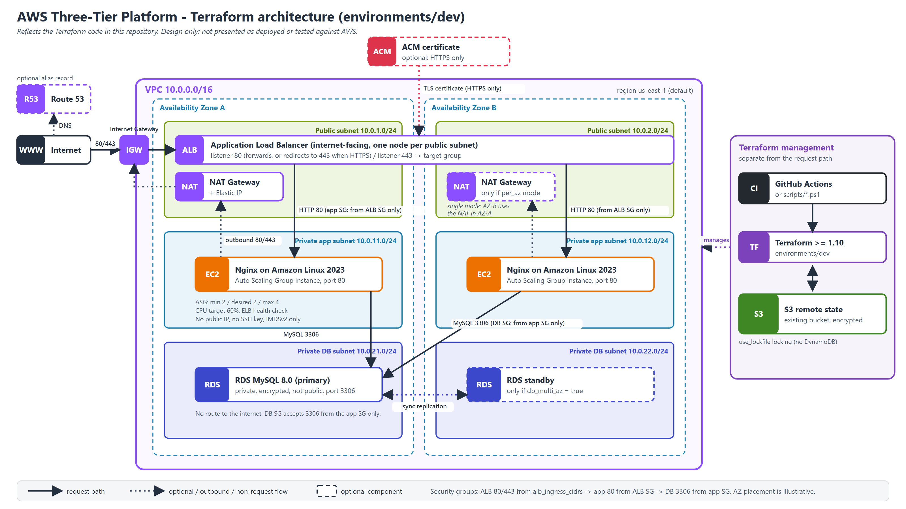

# AWS Enterprise Three-Tier Cloud Platform (Terraform)




Modular Terraform for a two-AZ, three-tier AWS platform: a public **Application Load Balancer**, a private **Auto Scaling** tier running **Nginx** on Amazon Linux 2023, and a private **RDS MySQL** database. Remote state lives in an existing S3 bucket with native lockfile locking.

> **Project status: not verified against AWS.**
> The code has been statically validated (`terraform fmt`, `init -backend=false`, `validate`). This README does not claim that any infrastructure is deployed, and the S3 backend, ACM, Route 53 and RDS behaviour have not been verified end to end. The deploy workflow can run `plan` and `apply` (see [CI/CD](#7-cicd-github-actions)), but nothing here states that a run succeeded. There are no test results, cost measurements or performance figures in this project.

## Contents

1. [Architecture](#1-architecture) · 2. [Repository layout](#2-repository-layout) · 3. [Networking](#3-networking) · 4. [ALB and HTTPS](#4-alb-and-https) · 5. [Application tier](#5-application-tier) · 6. [Database](#6-database) · 7. [CI/CD](#7-cicd-github-actions) · 8. [Terraform backend and variables](#8-terraform-backend-and-variables) · 9. [Deployment guide](#9-deployment-guide) · 10. [Cost warnings](#10-cost-warnings) · 11. [Troubleshooting](#11-troubleshooting)

## 1. Architecture

**Technology stack:** Terraform `>= 1.10`, AWS provider `~> 5.0`, VPC, ALB, ACM, Route 53, EC2 Auto Scaling (Amazon Linux 2023, Nginx), RDS MySQL 8.0, S3 remote state, GitHub Actions, PowerShell scripts.

**Traffic flow**

1. Clients resolve the name (Route 53 alias, only when `hosted_zone_id` is supplied) and reach the ALB through the Internet Gateway on port 80 or, when HTTPS is configured, 443.
2. With HTTPS enabled, the ALB terminates TLS with the ACM certificate, and port 80 redirects to 443.
3. The ALB forwards to Nginx in the private app subnets on port 80. The app security group accepts that port only from the ALB security group.
4. Instances reach MySQL on port 3306. The database security group accepts it only from the app security group.
5. Outbound: app subnets route `0.0.0.0/0` to a NAT Gateway (used to install Nginx). Database subnets have no internet route.

**Subnets** (defaults from `environments/dev/variables.tf`, VPC `10.0.0.0/16`)

| Tier | AZ A | AZ B |
|---|---|---|
| Public (ALB, NAT) | `10.0.1.0/24` | `10.0.2.0/24` |
| Private app (Nginx ASG) | `10.0.11.0/24` | `10.0.12.0/24` |
| Private DB (RDS) | `10.0.21.0/24` | `10.0.22.0/24` |

**Security design**

| Control | Where |
|---|---|
| Security groups reference each other (ALB -> app -> DB); no database ingress from CIDRs | `modules/security/main.tf` |
| No SSH, no key pair, IMDSv2 only, encrypted gp3 root volume | `modules/application/launch_template.tf` |
| DB subnets with no internet route; `publicly_accessible = false`; `storage_encrypted = true` | `modules/networking/main.tf`, `modules/database/main.tf` |
| TLS policy `ELBSecurityPolicy-TLS13-1-2-2021-06` by default | `modules/alb/variables.tf` |
| Plan fails without HTTPS unless `allow_http_only = true` | `modules/alb/main.tf` (precondition) |
| DB password via `TF_VAR_db_password`, or RDS-managed in Secrets Manager | `environments/dev/variables.tf` |
| Optional SSM access (off by default) instead of SSH | `enable_ssm` |

Known trade-offs: the app security group allows outbound 80/443 to `0.0.0.0/0` (package installs through NAT), and `alb_ingress_cidrs` defaults to `0.0.0.0/0`. A supplied DB password is stored in Terraform state, so protect the state bucket.

**About the diagram files**

- [`architecture/architecture.png`](architecture/architecture.png) (3200x1800) is rendered from [`architecture/architecture.svg`](architecture/architecture.svg), a hand-authored SVG, with headless Microsoft Edge. It was not generated from the Mermaid file.
- [`architecture/architecture.mmd`](architecture/architecture.mmd) is an equivalent Mermaid version that GitHub renders (below). No Mermaid renderer was available locally, so the Mermaid syntax has **not** been validated.
- AZ placement of the ALB nodes, primary database and optional standby is illustrative: AWS decides the standby location when `db_multi_az = true`.

To re-render the PNG after editing the SVG (Windows PowerShell):

```powershell
& "C:\Program Files (x86)\Microsoft\Edge\Application\msedge.exe" --headless=new --disable-gpu --hide-scrollbars `
  --force-device-scale-factor=2 --window-size=1600,900 --default-background-color=FFFFFFFF `
  --screenshot="$PWD\architecture\architecture.png" "file:///$($PWD.Path -replace '\\','/')/architecture/architecture.svg"
```

<details>
<summary>Mermaid version of the diagram</summary>


</details>

## 2. Repository layout

```text
.
├── .github/workflows/
│   ├── terraform-deploy.yml     # init -> validate -> plan -> apply
│   └── terraform-destroy.yml    # plan-destroy -> destroy
├── architecture/
│   ├── architecture.png         # rendered diagram
│   ├── architecture.svg         # diagram source for the PNG
│   └── architecture.mmd         # Mermaid version
├── environments/dev/
│   ├── backend.tf  providers.tf  versions.tf
│   ├── main.tf  variables.tf  outputs.tf
│   ├── terraform.tfvars.example
│   └── .terraform.lock.hcl
├── modules/
│   ├── networking/  security/  acm/  route53/
│   └── alb/  application/ (incl. user_data/nginx.sh)  database/
├── scripts/
│   ├── validate.ps1             # offline checks
│   └── deploy.ps1               # init + validate + plan, optional apply
├── LICENSE
└── README.md
```

| Module | Responsibility |
|---|---|
| `networking` | VPC, 6 subnets, IGW, NAT Gateway(s), route tables |
| `security` | ALB / app / DB security groups and rules |
| `acm` | DNS-validated certificate (only if `domain_name` is set) |
| `route53` | Alias record in an **existing** hosted zone (optional) |
| `alb` | ALB, target group + health check, listeners |
| `application` | AL2023 Launch Template, Nginx user data, ASG, CPU target-tracking policy, optional SSM role |
| `database` | DB subnet group and RDS MySQL |

**Root module wiring** (`environments/dev/main.tf`, excerpt):

```hcl
locals {
  # Known at plan time (unlike the certificate ARN), so it is safe to use for count.
  https_enabled = var.domain_name != ""
}

module "security" {
  source = "../../modules/security"

  name              = local.name
  vpc_id            = module.networking.vpc_id
  enable_https      = local.https_enabled
  alb_ingress_cidrs = var.alb_ingress_cidrs
  tags              = local.tags
}

module "alb" {
  source = "../../modules/alb"

  name                       = local.name
  vpc_id                     = module.networking.vpc_id
  public_subnet_ids          = module.networking.public_subnet_ids
  security_group_id          = module.security.alb_security_group_id
  enable_https               = local.https_enabled
  certificate_arn            = module.acm.certificate_arn
  allow_http_only            = var.allow_http_only
  enable_deletion_protection = var.alb_deletion_protection
  tags                       = local.tags
}
```

## 3. Networking

`modules/networking/main.tf` picks exactly two AZs dynamically, creates the VPC, six subnets, an Internet Gateway, NAT Gateway(s) and route tables.

```hcl
locals {
  azs = {
    a = data.aws_availability_zones.available.names[0]
    b = data.aws_availability_zones.available.names[1]
  }
  az_index = { a = 0, b = 1 }

  # One NAT Gateway in AZ-A ("single") or one per AZ ("per_az").
  nat_keys = !var.enable_nat_gateway ? [] : (var.nat_gateway_mode == "per_az" ? ["a", "b"] : ["a"])
}

resource "aws_nat_gateway" "this" {
  for_each = toset(local.nat_keys)

  allocation_id = aws_eip.nat[each.key].id
  subnet_id     = aws_subnet.public[each.key].id

  tags = merge(var.tags, { Name = "${var.name}-nat-${each.key}" })

  depends_on = [aws_internet_gateway.this]
}

# Database subnets have no route to the internet at all.
resource "aws_route_table" "private_db" {
  vpc_id = aws_vpc.this.id

  tags = merge(var.tags, { Name = "${var.name}-private-db-rt" })
}
```

Public subnets route to the IGW. Each private app subnet has its own route table that points to a NAT Gateway (the AZ-A one in `single` mode).

**Security groups** (`modules/security/main.tf`, excerpt). Rules are separate resources so the three groups can reference each other:

```hcl
resource "aws_vpc_security_group_ingress_rule" "app_from_alb" {
  security_group_id            = aws_security_group.app.id
  description                  = "App port from the ALB only"
  ip_protocol                  = "tcp"
  from_port                    = var.app_port
  to_port                      = var.app_port
  referenced_security_group_id = aws_security_group.alb.id
}

resource "aws_vpc_security_group_ingress_rule" "db_from_app" {
  security_group_id            = aws_security_group.db.id
  description                  = "MySQL from the application tier only"
  ip_protocol                  = "tcp"
  from_port                    = var.db_port
  to_port                      = var.db_port
  referenced_security_group_id = aws_security_group.app.id
}
```

## 4. ALB and HTTPS

`modules/alb/main.tf` fails the plan when neither HTTPS nor an explicit HTTP-only opt-in is set:

```hcl
lifecycle {
  precondition {
    condition     = var.enable_https || var.allow_http_only
    error_message = "No HTTPS listener is configured. Set a domain_name (ACM certificate) or explicitly set allow_http_only = true for development."
  }
}
```

The HTTPS listener exists only when HTTPS is enabled, and port 80 either redirects to 443 or forwards (HTTP-only development):

```hcl
resource "aws_lb_listener" "https" {
  count = var.enable_https ? 1 : 0

  load_balancer_arn = aws_lb.this.arn
  port              = 443
  protocol          = "HTTPS"
  ssl_policy        = var.ssl_policy
  certificate_arn   = var.certificate_arn

  default_action {
    type             = "forward"
    target_group_arn = aws_lb_target_group.app.arn
  }
}
```

**Domain and DNS**

- **No domain** (`domain_name = ""`): no certificate and no HTTPS listener. You must set `allow_http_only = true` explicitly, otherwise the plan fails. Traffic is **plain HTTP and unencrypted**; use for development only. Reach the site via the `application_url` output.
- **With a domain**: set `domain_name`. An ACM certificate (DNS validation) is created in the same region as the ALB, the ALB gets an HTTPS listener, and port 80 redirects to 443.
  - With `hosted_zone_id` (an **existing** public zone containing the domain): validation CNAMEs and the alias record are created automatically.
  - Without `hosted_zone_id`: `apply` waits (up to 45 min) for you to create the CNAME records shown in the `certificate_domain_validation_options` output at your DNS provider, and no alias record is created.
- Prerequisites: you own the domain and its DNS is served by the hosted zone. This project never registers domains or creates hosted zones. **DNS delegation to the hosted zone must be verified separately**; this repository does not check it.
- The zone ID and the domain must match what Terraform receives. In CI the zone ID is looked up at plan time (see [CI/CD](#7-cicd-github-actions)).

## 5. Application tier

`modules/application/` creates the Launch Template, Auto Scaling group and a CPU target-tracking policy. Instances have no key pair, require IMDSv2, and use an encrypted gp3 root volume.

```hcl
resource "aws_autoscaling_group" "app" {
  name_prefix         = "${var.name}-app-"
  vpc_zone_identifier = var.private_subnet_ids # both private app subnets => both AZs
  min_size            = var.min_size
  desired_capacity    = var.desired_capacity
  max_size            = var.max_size

  target_group_arns         = [var.target_group_arn]
  health_check_type         = "ELB"
  health_check_grace_period = var.health_check_grace_period
  # ...
}

resource "aws_autoscaling_policy" "cpu" {
  name                   = "${var.name}-cpu-target"
  autoscaling_group_name = aws_autoscaling_group.app.name
  policy_type            = "TargetTrackingScaling"

  target_tracking_configuration {
    predefined_metric_specification {
      predefined_metric_type = "ASGAverageCPUUtilization"
    }
    target_value = var.cpu_target_utilization
  }
}
```

Defaults: `t3.micro`, min 2 / desired 2 / max 4, CPU target 60, health-check grace period 300 s.

**Nginx user data** (`modules/application/user_data/nginx.sh`, excerpt). It installs Nginx through the NAT Gateway with retries, reads instance identity via IMDSv2, writes a demo page and starts the service:

```bash
for attempt in 1 2 3 4 5; do
  if dnf install -y nginx; then
    break
  fi
  echo "[user-data] dnf install failed (attempt ${attempt}); retrying in 10s"
  sleep 10
done

cat > /usr/share/nginx/html/index.html <<EOF
<!doctype html>
<html><head><title>Three-tier demo</title></head>
<body>
<h1>Nginx is running</h1>
<p>Instance: ${INSTANCE_ID}</p>
<p>Availability Zone: ${AZ}</p>
</body></html>
EOF

nginx -t
systemctl enable nginx
systemctl restart nginx
```

## 6. Database

`modules/database/main.tf` creates a private, encrypted RDS MySQL instance. Either a supplied sensitive password or an RDS-managed Secrets Manager password is used:

```hcl
resource "aws_db_instance" "this" {
  identifier = "${var.name}-mysql"

  engine         = "mysql"
  engine_version = var.engine_version
  instance_class = var.instance_class

  storage_type      = "gp3"
  storage_encrypted = true

  db_subnet_group_name   = aws_db_subnet_group.this.name
  vpc_security_group_ids = [var.security_group_id]
  publicly_accessible    = false
  multi_az               = var.multi_az # improves availability; roughly doubles instance cost

  deletion_protection       = var.deletion_protection
  skip_final_snapshot       = var.skip_final_snapshot
  final_snapshot_identifier = var.skip_final_snapshot ? null : "${var.name}-mysql-final"
  # ...
}
```

Defaults: MySQL `8.0`, `db.t3.micro`, 20 GB, database `appdb`, user `dbadmin`, 7-day backups, Multi-AZ off, final snapshot on destroy.

**Outputs** (`environments/dev/outputs.tf`, excerpt):

```hcl
output "application_url" {
  description = "URL to reach the application."
  value       = local.https_enabled ? "https://${var.domain_name}" : "http://${module.alb.alb_dns_name}"
}

output "db_endpoint" {
  description = "RDS MySQL endpoint (reachable only from the application tier)."
  value       = module.database.endpoint
}
```

Other outputs: `vpc_id`, `availability_zones`, `alb_dns_name`, `certificate_domain_validation_options`, `autoscaling_group_name`, `db_master_user_secret_arn`.

## 7. CI/CD (GitHub Actions)

`.github/workflows/terraform-deploy.yml` runs on **manual dispatch** (`workflow_dispatch`) in `environments/dev`:

| Job | Needs | What it does |
|---|---|---|
| `init` | none | Requires `AWS_REGION` to be `us-east-1`, configures AWS credentials, runs `terraform init -input=false` |
| `validate` | `init` | `terraform init`, `terraform fmt -check -recursive`, `terraform validate` |
| `plan` | `validate` | Verifies identity, looks up the public Route 53 zone, requires the DB password secret, runs `terraform plan -out=tfplan`, uploads `tfplan` as artifact `terraform-plan` (kept 1 day) |
| `apply` | `plan` | Downloads `terraform-plan`, runs `terraform init`, then applies the saved plan |

```yaml
  apply:
    name: Terraform Apply
    needs: plan
    # ...
      - name: Apply saved Terraform plan
        env:
          TF_VAR_db_password: ${{ secrets.TF_VAR_DB_PASSWORD }}
        run: |
          terraform apply \
            -input=false \
            -auto-approve \
            -lock-timeout=60s \
            tfplan
```

**There is no approval gate on `apply`: a successful plan is applied automatically and creates billable resources.** The saved plan can contain sensitive values (including the DB password), so restrict access to workflow artifacts. A workflow-level `concurrency` group (`terraform-aws-dev`, no cancellation) prevents overlapping runs, and the S3 lockfile protects state.

`.github/workflows/terraform-destroy.yml` is a separate manual workflow: you type `DESTROY`, it creates a destroy plan, and its `destroy` job runs in the `production` GitHub environment. **Known gap:** it does not set `TF_VAR_domain_name` or `TF_VAR_allow_http_only`, so the ALB precondition may fail there.

Workflow configuration (names only, no values):

| Kind | Name | Used for |
|---|---|---|
| Repository variable | `AWS_REGION` | Must be `us-east-1` |
| Secrets | `AWS_ACCESS_KEY_ID`, `AWS_SECRET_ACCESS_KEY` | AWS credentials |
| Secret | `TF_VAR_DB_PASSWORD` | Passed as `TF_VAR_db_password` |
| Workflow env | `TF_VAR_domain_name`, `TF_VAR_allow_http_only` | HTTPS domain and HTTP-only switch (set in the deploy workflow file) |
| Computed at plan time | `TF_VAR_hosted_zone_id` | Looked up from the public Route 53 zone with the same name as the domain |

## 8. Terraform backend and variables

**Providers and versions** (`environments/dev/providers.tf`, `versions.tf`):

```hcl
provider "aws" {
  region = var.region
}

terraform {
  required_version = ">= 1.10.0"

  required_providers {
    aws = {
      source  = "hashicorp/aws"
      version = "~> 5.0"
    }
  }
}
```

**Backend** (`environments/dev/backend.tf`, comments omitted):

```hcl
terraform {
  backend "s3" {
    bucket       = "states.tf-2026-test-1"
    key          = "enterprise-three-tier/dev/terraform.tfstate"
    encrypt      = true
    use_lockfile = true
    region       = "us-east-1"
  }
}
```

The project uses the **existing** bucket `states.tf-2026-test-1` and does not create it; it must already exist and ideally have versioning enabled. No DynamoDB table is used (S3-native locking).

**Bucket region.** An unauthenticated HEAD request to S3 returned `403` with `x-amz-bucket-region: us-east-1`, so a bucket with this name exists in `us-east-1`. That does not prove the bucket belongs to your account, and your access to it is unverified. Confirm with valid credentials:

```powershell
aws sts get-caller-identity                                   # shows account/ARN only, no secrets
aws s3api get-bucket-location --bucket states.tf-2026-test-1  # null/"None" means us-east-1
aws s3api head-bucket --bucket states.tf-2026-test-1          # exit 0 = exists and you may access it
aws s3api get-bucket-versioning --bucket states.tf-2026-test-1
```

If it differs, edit `region` in `backend.tf` or run `terraform init -backend-config="region=<bucket-region>"`. Credentials are never stored in the backend block. If the bucket already holds state under this key, inspect and back it up before any `init`.

**Variables.** `environments/dev/terraform.tfvars.example` (excerpt):

```hcl
region       = "us-east-1"
project_name = "three-tier"
environment  = "dev"

nat_gateway_mode = "single"

domain_name     = ""
allow_http_only = true

instance_type        = "t3.micro"
asg_min_size         = 2
asg_desired_capacity = 2
asg_max_size         = 4

db_instance_class = "db.t3.micro"
db_multi_az       = false
```

A typical declaration (`environments/dev/variables.tf`):

```hcl
variable "nat_gateway_mode" {
  description = "\"single\" (one NAT, cheapest, dev default) or \"per_az\" (one NAT per AZ, higher availability, about double the NAT cost)."
  type        = string
  default     = "single"
}
```

## 9. Deployment guide

Run commands from the project root in Windows PowerShell. Step 5 is offline; steps 2, 6, 7, 8, 9 and 10 contact AWS (step 9 only if you query the deployed site or console).

### 1. Prerequisites

- Terraform `>= 1.10` (needed for `use_lockfile`), AWS provider `~> 5.0`, Windows PowerShell 5.1 or PowerShell 7, AWS CLI (optional).
- AWS credentials able to create the resources above (EC2/VPC, ELBv2, AutoScaling, RDS, IAM role creation if `enable_ssm`, ACM and Route 53 if used) and read/write the state bucket.

### 2. Configure AWS credentials securely (contacts AWS)

Use `aws configure`, `aws configure sso`, or environment variables you set yourself. Never put keys in files. Check which identity is active without printing secrets:

```powershell
aws configure list-profiles
aws sts get-caller-identity                      # default profile
aws sts get-caller-identity --profile dev_profile
$env:AWS_PROFILE = "dev_profile"                 # pick the profile Terraform should use
```

`InvalidClientTokenId` usually means a wrong, expired, or revoked key or session token, or stale `AWS_*` environment variables overriding the profile.

### 3. Configure the existing S3 backend

Confirm the bucket, region and access as shown in [section 8](#8-terraform-backend-and-variables). Edit `environments/dev/backend.tf` only if your bucket differs.

### 4. Configure variables and database credentials

Copy `environments/dev/terraform.tfvars.example` to `terraform.tfvars` (git-ignored) and edit non-secret values. For HTTPS, set `domain_name` (and `hosted_zone_id` for an existing public zone) and `allow_http_only = false`.

The database password is sensitive and must not go in files:

```powershell
$env:TF_VAR_db_password = Read-Host "DB password" -MaskInput   # PowerShell 7
# Windows PowerShell 5.1: $env:TF_VAR_db_password = "<type it>"  (avoid saving it in shell history files)
```

Alternative: `db_manage_master_user_password = true` lets RDS keep the password in Secrets Manager (not in state; small extra cost). A supplied password is stored in Terraform state, so protect the state bucket.

### 5. Format and validate (offline)

`scripts/validate.ps1` runs `fmt -check`, `init -backend=false` and `validate`. It makes no AWS calls.

```powershell
.\scripts\validate.ps1

# Or manually
terraform fmt -recursive
```

### 6. Initialize Terraform (contacts AWS)

Uses the S3 backend, so it needs working credentials.

```powershell
terraform -chdir=environments/dev init
terraform -chdir=environments/dev validate
```

### 7. Generate and review the plan (contacts AWS)

```powershell
terraform -chdir=environments/dev plan -out=dev.tfplan
terraform -chdir=environments/dev show dev.tfplan

# Or: init + validate + plan in one go (never applies)
.\scripts\deploy.ps1
```

Check: the add/change/destroy counts; no `-/+` replacements or destroys you did not expect; subnet CIDRs and the two AZs; one NAT Gateway (or two); security group sources are SG references, not `0.0.0.0/0`, apart from ALB 80/443; `publicly_accessible = false`; `multi_az` as intended; no secrets exposed. Plan files can contain sensitive data: never commit them.

### 8. Apply only when appropriate (creates billable resources)

Only after a human has reviewed the plan:

```powershell
.\scripts\deploy.ps1 -Apply      # asks you to type 'apply', then applies the saved plan
# or
terraform -chdir=environments/dev apply dev.tfplan
```

With HTTPS and a hosted zone, `apply` waits for ACM certificate validation. If DNS delegation to the zone is not in place, it waits until the timeout.

### 9. Verify the deployment

Nothing in this repository records a successful deployment; use these checks after your own apply:

```powershell
terraform -chdir=environments/dev output application_url
terraform -chdir=environments/dev output db_endpoint
curl.exe -I (terraform -chdir=environments/dev output -raw application_url)
```

The demo page shows the instance ID and AZ, so repeated requests should show instances from both AZs. In the AWS console, check that ALB targets are healthy and that the ASG has instances in both private app subnets.

### 10. Destroy resources safely when finished (contacts AWS)

1. Back up anything you need from the database. By default a final snapshot (`<name>-mysql-final`) is taken on destroy; `db_skip_final_snapshot = true` makes deletion unrecoverable. If `db_deletion_protection = true`, disable it first.
2. `terraform -chdir=environments/dev plan -destroy` and review it. Then `terraform -chdir=environments/dev destroy` (billing stops only after resources are gone).
3. **Never delete the state object or bucket before destroying**: Terraform would lose track of live resources. The state bucket is not managed by this project and is not removed by `destroy`.
4. A second destroy of the same database fails if the earlier final snapshot still exists; delete or rename that snapshot.

## 10. Cost warnings

Nothing here has been priced or measured. These resources are billable while they exist:

| Resource | Why it costs | Notes |
|---|---|---|
| **NAT Gateway** | Hourly charge plus per-GB processing, plus the Elastic IP | Default `nat_gateway_mode = "single"` (one NAT in AZ-A, cheaper, but an AZ-A failure removes outbound access for both AZs). `"per_az"` gives one NAT per AZ, roughly double the NAT cost |
| **Application Load Balancer** | Hourly plus LCU charges | Billed while it exists |
| **EC2 / Auto Scaling** | Two `t3.micro` instances by default (min 2, max 4) plus gp3 EBS volumes | Scales with CPU load up to `asg_max_size` |
| **RDS MySQL** | Instance, storage, and backups | **Multi-AZ** (`db_multi_az = true`) improves availability but roughly doubles the instance cost; off by default |
| Route 53 | Hosted zone and query charges | The zone is pre-existing and not created here |

Billing stops only after the resources are gone.

## 11. Troubleshooting

- **"No HTTPS listener is configured"**: neither `domain_name` nor `allow_http_only = true` reached Terraform. In CI the workflow env must set one of them; locally check `terraform.tfvars`.
- **Hosted zone not found in CI**: the plan job could not find a public zone with the same name as the domain in the account, so the step fails. Check the zone name and account.
- **Certificate stays pending**: DNS delegation to the hosted zone is missing, or validation records were not created. Check `certificate_domain_validation_options`.
- **Instances unhealthy**: user data logs to `/var/log/user-data.log` (also `/var/log/cloud-init-output.log`). Instances have no SSH; set `enable_ssm = true` for Session Manager access. Targets unhealthy right after launch is normal for up to the 300 s grace period; persistent failure usually means no NAT egress (Nginx install failed).
- **State lock errors**: another run holds the S3 lockfile. The workflow uses `-lock-timeout=60s`.
