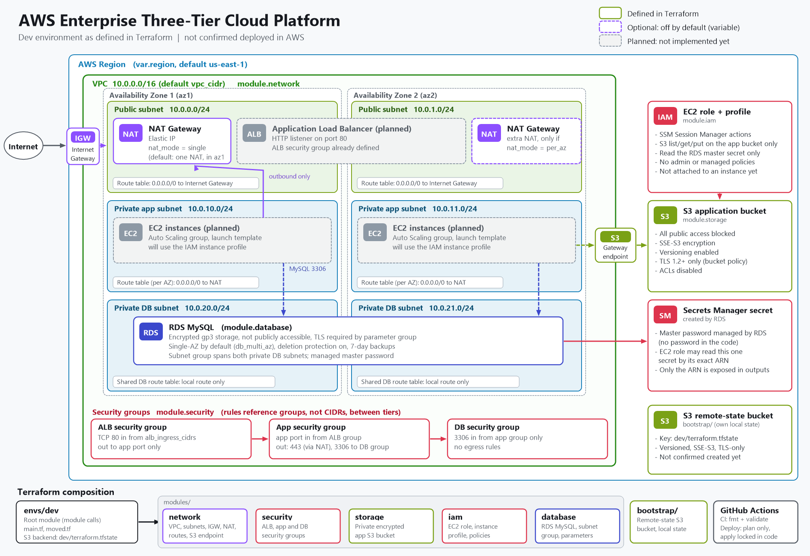

# AWS Enterprise Three-Tier Cloud Platform

[](https://github.com/sabo1166/terraform-AWS-Enterprise-Three-Tier-Cloud-Platform/actions/workflows/terraform.yml)


A modular Terraform foundation for a three-tier application on AWS: a two-AZ VPC with public, private application and private database subnets, a private encrypted RDS MySQL instance, a private encrypted S3 bucket, and a least-privilege IAM role for the future application servers. It is built in reviewed phases, and every phase is checked locally before the next one starts.

> **Project status**
> The network, security group, storage, IAM and database layers are written and pass `terraform fmt` and `terraform validate`. The configuration has **not been planned or applied against AWS**, so nothing in this repository is confirmed as deployed. The load balancer and the EC2 Auto Scaling tier are **not implemented yet**; they appear as planned components in the diagram.

## Architecture



The diagram shows only what the Terraform code defines, and marks what is optional or not built yet. Open the image for full size, or read [docs/architecture.md](docs/architecture.md) for the same information in text form.

| Tier | What the code defines today | Status |
|---|---|---|
| Edge | Internet Gateway and a public route table. Public subnets have room for an ALB. | ALB planned, not implemented |
| Application | Private subnets, per-AZ route tables through NAT, an S3 gateway endpoint, app security group, EC2 IAM role and instance profile. | EC2 Auto Scaling planned, not implemented |
| Data | Private DB subnets with no internet route, DB subnet group, parameter group, encrypted RDS MySQL, DB security group. | Defined |
| Storage | Private application S3 bucket and a remote-state bucket (`bootstrap/`). | Defined |

## Key features

- **Two Availability Zones**, six subnets (public, private app, private database per AZ) carved from one configurable VPC CIDR.
- **Selectable NAT strategy** with `nat_mode`: `single` (default, cheaper) or `per_az` (one NAT per AZ, no cross-AZ dependency).
- **Free S3 gateway endpoint** on the app route tables, which keeps S3 traffic off the NAT.
- **Security group chain** ALB, app, database. Tier-to-tier rules reference security groups, not CIDR ranges.
- **Private RDS MySQL** with encrypted storage, TLS required by the parameter group, and a master password that RDS generates and stores in Secrets Manager.
- **Reusable modules**: `network`, `security`, `storage`, `iam`, `database`, called from `envs/dev`.
- **Safe refactoring**: `envs/dev/moved.tf` maps all 40 resources from the earlier flat layout to their module addresses.
- **CI**: formatting and offline validation on every pull request and push.

## Security design

What the code implements:

- **Network:** database subnets have no internet route in either direction, and the database is not publicly accessible. The VPC default security group has no rules. Public subnets do not auto-assign public IPs.
- **Security groups:** the database accepts only the app group on the database port and has no egress rules. The app group accepts only the ALB group, and sends out only HTTPS (via NAT) and the database port.
- **Encryption:** RDS storage is encrypted at rest and requires TLS. S3 buckets use SSE-S3, and the app bucket denies non-TLS access and TLS older than 1.2.
- **S3:** all four public-access blocks are on, ACLs are disabled, and versioning is enabled.
- **IAM:** the EC2 role is trusted only by `ec2.amazonaws.com` and has no managed or admin policies. Its three inline policies cover Session Manager actions, list/get/put on the one application bucket, and read access to the one RDS master secret by its exact ARN. The Session Manager statement uses `Resource = "*"` because those actions cannot be scoped.
- **Secrets:** no passwords, keys or tokens are in the code. `.gitignore` excludes state, saved plans, real `*.tfvars` and `*backend*.hcl`.
- **Deletion safety:** RDS deletion protection is on by default with a final snapshot, and the state bucket has `prevent_destroy`.

Known gaps are listed under [Current limitations](#current-limitations). More detail: [docs/security.md](docs/security.md).

## Repository structure

```
.
├── .github/
│   ├── actions/terraform-env/    Shared action: AWS credentials, Terraform, backend init
│   └── workflows/
│       └── terraform.yml         CI checks, plus manual init, plan; apply locked in code
├── bootstrap/                    Remote-state S3 bucket (own local state, applied once)
├── docs/
│   ├── architecture.md           Architecture in text form
│   ├── architecture.png          Architecture diagram
│   ├── implementation-notes.md   Phase log, cost drivers, GitHub Actions notes, risks
│   └── security.md               Security design and open risks
├── envs/
│   └── dev/                      Dev environment
│       ├── main.tf               Module calls
│       ├── moved.tf              State-address mapping for the module refactor
│       ├── variables.tf  locals.tf  outputs.tf  versions.tf  providers.tf
│       ├── backend.hcl.example   S3 backend settings template
│       └── terraform.tfvars.example
├── modules/
│   ├── network/                  VPC, subnets, IGW, NAT, routes, S3 endpoint
│   ├── security/                 ALB, app and DB security groups and rules
│   ├── storage/                  Private encrypted application bucket
│   ├── iam/                      EC2 role, instance profile, inline policies
│   └── database/                 RDS MySQL, subnet group, parameter group
├── .gitignore
└── README.md
```

## Terraform modules

Each module has `main.tf`, `variables.tf`, `outputs.tf` and `versions.tf`.

| Module | Purpose | Main inputs | Main outputs |
|---|---|---|---|
| `network` | VPC, two public, two app and two DB subnets, IGW, NAT gateway(s), route tables, S3 gateway endpoint, locked-down default security group | `name_prefix`, `vpc_cidr`, `nat_mode` | VPC and subnet IDs, NAT gateway IDs, AZ names |
| `security` | ALB, app and DB security groups with explicit rules | `vpc_id`, `alb_ingress_cidrs`, `app_port`, `db_port` | Security group IDs |
| `storage` | Private application bucket with encryption, versioning and a TLS-only policy | `name_prefix` | Bucket name and ARN |
| `iam` | EC2 role, instance profile, SSM, S3 and DB-secret inline policies | `app_bucket_arn`, `db_secret_arn` | Role ARN and name, instance profile name |
| `database` | DB subnet group, parameter group, encrypted RDS MySQL with a managed master secret | `subnet_ids`, `security_group_id`, `db_*` settings | Endpoint, port, instance ARN, secret ARN |

Dependencies: `network` feeds `security` and `database`; `storage` and `database` feed `iam`.

Key variables for `envs/dev` (all have defaults; see `variables.tf` for validation rules):

| Variable | Default | Notes |
|---|---|---|
| `region` | `us-east-1` | Must match the state bucket region |
| `vpc_cidr` | `10.0.0.0/16` | Validated to be between /16 and /18 |
| `nat_mode` | `single` | `per_az` doubles NAT cost |
| `alb_ingress_cidrs` | `["0.0.0.0/0"]` | Restrict to your own IP while testing |
| `db_instance_class` | `db.t4g.micro` | Main database cost driver |
| `db_multi_az` | `false` | Set `true` for production-style resilience |
| `db_deletion_protection` | `true` | Set `false` and apply before any destroy |

## Prerequisites

- Terraform 1.10 or later (CI uses 1.16.2).
- An AWS account and credentials with permission to create the resources above. Use a dedicated, least-privilege identity.
- AWS CLI (optional, for credential setup).
- A decision about the region. It must match the state bucket's region.

## Safe deployment

Nothing here has been run against AWS by the project author. Review every plan before any apply. Steps that contact AWS or change infrastructure are marked.

```powershell
# 1. Offline checks (no AWS access)
terraform fmt -check -recursive
cd envs/dev
terraform init -backend=false
terraform validate
cd ..\..
```

```powershell
# 2. State bucket (contacts AWS; creates a bucket on apply)
cd bootstrap
terraform init
terraform plan                  # review before applying
terraform apply                 # only after reviewing the plan
terraform output state_bucket_name
cd ..
```

```powershell
# 3. Environment (contacts AWS)
cd envs/dev
copy backend.hcl.example backend.hcl            # set bucket; keep key dev/terraform.tfstate
copy terraform.tfvars.example terraform.tfvars  # adjust values; no secrets here
terraform init -backend-config=backend.hcl
terraform plan                                  # review carefully
```

Notes on the first plan:

- If a state already exists from the earlier flat layout, the plan should show the resources as **moves** (via `moved.tf`) with no destroy or replacement. Treat any destroy or replacement as a stop sign and investigate.
- If the state is empty, the plan creates everything. That includes a NAT gateway and an RDS instance, which are billable.
- Only apply after reading the plan. To destroy the dev database later, set `db_deletion_protection = false` and apply that change first; a repeat destroy also needs the earlier final snapshot removed.

## Validation and CI

One workflow, `.github/workflows/terraform.yml`, with four sequential jobs: `init`, `validate`, `plan`, `apply`.

| Trigger | Jobs that run | What happens |
|---|---|---|
| Pull request, or push to `main` / `refactor/modules` | `validate` only | `terraform fmt -check -recursive`, then `init -backend=false` and `validate` in `envs/dev` and `bootstrap`. No AWS credentials, no backend, no plan. |
| Manual run (`workflow_dispatch`) | `init`, `validate`, `plan` | `init` verifies the remote state is readable, `plan` reports creates, updates, destroys, replaces and moves, and fails safely on missing, empty or unexpected state. |
| Manual run with `apply=true` | `apply` (locked) | **The apply job is locked in code and does not run.** When unlocked it would apply the exact fingerprinted plan from an encrypted artifact, from `main` only, after `production` environment approval. |

Local checks performed on this code: `terraform fmt -check -recursive` and `terraform validate` in both roots, with `init -backend=false`. The workflow has not run on GitHub yet. Its open security blockers are documented in [docs/implementation-notes.md](docs/implementation-notes.md).

## Cost considerations

Prices vary by region and change over time, so check the AWS pricing pages before applying. Main cost drivers:

- **NAT Gateway:** hourly charge plus per-GB processing. It is the largest idle cost, and `nat_mode = "per_az"` doubles it.
- **RDS:** the instance class dominates; `db_multi_az = true` roughly doubles it. Storage and backup storage above the instance size are extra.
- **Secrets Manager:** a small per-secret monthly charge.
- **S3:** usage-based. Versioning keeps old object versions until a lifecycle rule is added.
- **Not built yet:** an ALB, EC2 instances and CloudWatch would add their own costs.

The S3 gateway endpoint, VPC, subnets, route tables, Internet Gateway and security groups are free.

## Current limitations

- **Not deployed or tested in AWS.** No `plan` or `apply` has been run, so engine and instance availability, IAM behavior and the first plan are unverified.
- **Application tier missing:** no ALB, EC2 launch template or Auto Scaling group.
- **HTTP only:** HTTPS needs a domain and an ACM certificate.
- **No CloudFront, WAF, VPC flow logs or CloudWatch alarms.**
- **Single environment:** only `envs/dev` exists.
- **Deploy workflow:** apply is locked. Plan and apply would share the same AWS keys, and branch protection and the `production` environment are not verified. See [docs/implementation-notes.md](docs/implementation-notes.md).
- **Session Manager permissions** are the minimal documented set and have not been tested on a running instance.
- **Provider lock files** were generated on Windows and not yet confirmed on Linux runners.

## Roadmap

1. Application tier: ALB, target group, launch template (IMDSv2, encrypted EBS) and Auto Scaling group.
2. Monitoring: CloudWatch alarms, SNS notifications and RDS log exports.
3. HTTPS with ACM and Route 53, then optional CloudFront and WAF.
4. A `prod` environment with Multi-AZ RDS and per-AZ NAT.
5. Safer CD: separate read-only plan credentials, GitHub environment protection, then enabling apply.

## Documentation

- [Architecture](docs/architecture.md)
- [Security](docs/security.md)
- [Implementation notes](docs/implementation-notes.md)
